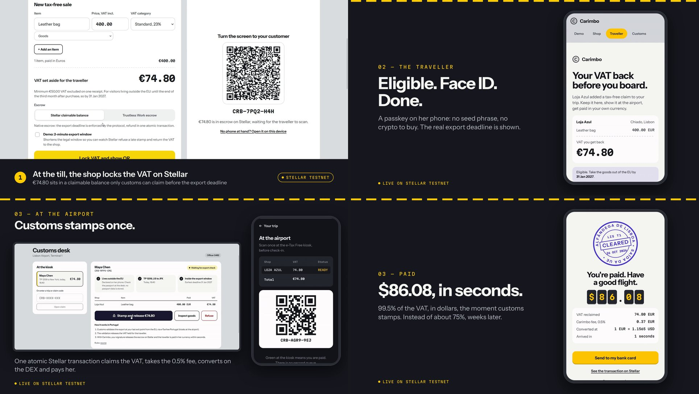
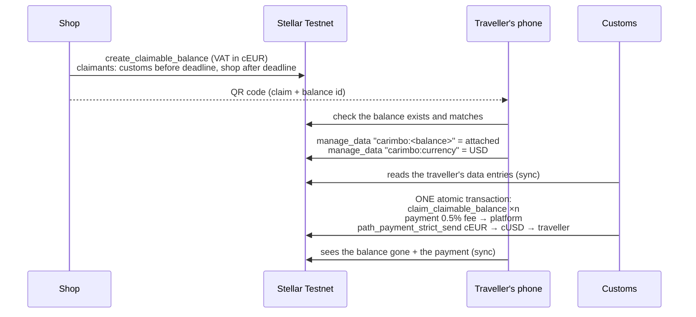

# Carimbo

**Tax-free refunds that land in the traveller's own currency the moment customs clears them, on Stellar.**

*Carimbo* is Portuguese for *stamp*. In Carimbo, the customs stamp is the payment.

- **Live app:** https://carimbo-six.vercel.app (Stellar Testnet)
- **Demo video (2 min):** https://youtu.be/R3esjXFGgm0
- **Track:** HackMeridian 2026 · Genesis · Stellar Unlocked
- **Team:** Ferdinand Robichon, Nicolas Felemez
- **Built during the event** (25–26 October 2026, Lisbon). No prior work.

[](https://youtu.be/R3esjXFGgm0)



---

## The problem

Visitors who live outside a country can reclaim the VAT on what they buy there and take home. In practice they lose a large part of it, or wait for it:

| Where | Who refunds | What the traveller loses |
|---|---|---|
| EU, Switzerland, Norway, Singapore, Korea | Private refund operators (Global Blue, Planet…) | Around **a quarter of the reclaimable VAT** in fees. Portugal: 23% VAT is 18.7% of the price, but travellers net about 14–16%. |
| United Arab Emirates | One licensed operator | Only 85% of the VAT, minus a fixed fee per receipt |
| Australia | The state, no fee | Nothing, but cards and bank accounts are credited **within 60 days** |
| Japan | Switching to a refund model on 1 November 2026 | Methods not standardised; the government is studying stablecoin refunds |

The market is large: Global Blue alone processed **€28 bn** of tax-free sales and earned **€422 m** in a year, across 53 countries.

The root cause is the same everywhere. Validating the export is already electronic: Portugal's e-Tax Free kiosks, for example. **Paying a foreigner, in their own currency, at the moment they leave, is what is expensive.** That gap is what intermediaries charge for, and it is exactly the job Stellar was built for.

## What Carimbo does

1. **At the till**, the shop enters the receipt: several items, each with its VAT category. The VAT is computed with the rules of the shop's country (22 countries built in) and **locked on Stellar**. A sale the law excludes cannot be locked, and the till says why. The traveller scans a QR code.
2. **On the traveller's phone**, she declares only what that country's rules need (residence, dates, exit point, and age or cabin baggage where required). The eligibility engine then shows whether the receipt can be refunded, why not, and what would fix it. Eligible receipts are checked against the ledger and added to the trip. Receipts from several shops add up, and the traveller chooses the currency they want to be paid in.
3. **At the airport**, customs opens the trip and stamps once. One atomic Stellar transaction releases every receipt, takes a 0.5% fee, **converts on the Stellar DEX** and pays the traveller.
4. **If the traveller never leaves the country**, the shop takes its VAT back after the legal deadline. The Stellar protocol enforces this, not our app.

The traveller gets **99.5%** of the VAT instead of about 75%, in seconds, in dollars, yen, pounds or reais.

## How Stellar is used

Carimbo is built on Stellar's native primitives. There is no backend server: the browser talks to Stellar Testnet, and the ledger is the shared state between devices.



| Need | Stellar feature | Where in the code |
|---|---|---|
| Lock the VAT until export, with a legal deadline | **Claimable balances with time predicates**: customs may claim *before* the deadline, the shop only *after* it | `chainOpen` in `web/src/lib/stellar.ts` |
| Return the VAT if the traveller never leaves | Shop's claimant predicate `not(before_absolute_time(deadline))` | `chainReclaim` |
| Pay in the traveller's currency | **Built-in DEX** and **path payments** (`path_payment_strict_send`, path found with Horizon `strict-send-paths`) | `chainRelease` |
| All-or-nothing refund | Several operations in **one atomic transaction**: claim, fee, conversion, payout | `chainRelease` |
| Stablecoins per currency | **Issued assets** with trustlines: cEUR, cUSD, cGBP, cJPY, cBRL, cCNY, cCHF, cSGD, cKRW | `web/src/views/Setup.tsx` |
| Liquidity between currencies | Market-maker **offers** on the DEX, two-sided around a reference rate | `Setup.tsx` |
| Shared state across devices, no server | Traveller **data entries** (`manage_data`) and Horizon reads, polled every 4 s | `web/src/lib/sync.ts` |
| Deadline enforced by the network | A late customs stamp fails on-chain with `op_cannot_claim`; the shop's reclaim succeeds. Shown live with the 2-minute demo window | `chainRelease`, `chainReclaim` |
| Survive a busy public Testnet | Lookup by transaction hash and safe resubmission after a 504 | `submitClassicTx` |

### Escrow by Trustless Work (HackMeridian partner)

At the till, the shop can choose **Trustless Work escrow** instead of the native claimable balance ([`web/src/lib/trustless.ts`](web/src/lib/trustless.ts)). The app calls Trustless Work's REST API, which returns unsigned transactions; each actor signs its own in the browser:

| Step | Trustless Work call | Signed by |
|---|---|---|
| Lock the VAT | `deployer/single-release`, then `fund-escrow` | the shop |
| Customs stamp | `change-milestone-status` → `approve-milestone` → `release-funds` | customs (service provider, approver, release signer) |
| Refusal | `dispute-escrow` → `resolve-dispute` back to the shop | customs (dispute resolver) |
| Conversion | Stellar DEX path payment, USDC → the traveller's currency | the traveller |

**On-chain evidence**, one refund through Trustless Work (Casa Verde, €37.40 of VAT escrowed as 43.38 USDC):

1. Customs approves the milestone and releases the escrow, 43.03 USDC reach the traveller: [`081e4980…2ba9`](https://stellar.expert/explorer/testnet/tx/081e4980b4b1e427425124ec754a3c307fc94bc0a9bbb31cef599fd668952ba9)
2. The DEX converts them, the traveller holds **$42.77**: [`3edbc41b…dc1c`](https://stellar.expert/explorer/testnet/tx/3edbc41bbb512a9e4096a29fcf0a7684f2dc1dd80be9d32d3688e3790acddc1c)

Their Testnet API holds Circle's **USDC**, so on this path the VAT is escrowed in USDC at the reference rate. Carimbo's 0.5% goes to the platform role; Trustless Work takes its own protocol fee. The phone follows the escrow through Trustless Work's indexer (`get-escrow-by-contract-ids`).

### Testnet deployment

All accounts are created and funded by `/#/setup`, and the result is committed as [`web/public/chain.json`](web/public/chain.json). The five shops are fictional Lisbon boutiques, each with its own Testnet account; shops added later are activated by *Activate the shops* on the same page.

| Role | Account |
|---|---|
| Stablecoin issuer | [`GAES72GC…QKMD`](https://stellar.expert/explorer/testnet/account/GAES72GCJQZ4H5YAFPO6AQPP7OTAF2HYIJLE2O3F6EDBNG2ML2BXQKMD) |
| Customs signer | [`GBHEL52N…VRXS`](https://stellar.expert/explorer/testnet/account/GBHEL52NNUONBCXPYRBS2H5USLHMZBMQAG4AKMTSPSUNFB36QM67VRXS) |
| Shop: Loja Azul | [`GAERIXHJ…LJWZ`](https://stellar.expert/explorer/testnet/account/GAERIXHJVCRREBD36TDWAKZ6HWEWIRBIFIJDMLVXABX4C4P4XYXXLJWZ) |
| Shop: Casa Verde | [`GAYSK5GX…7ZWK`](https://stellar.expert/explorer/testnet/account/GAYSK5GXB2YJJRYJSMXB6SLVZV7RX6MGCAYBPTRRRT5PMBDEJXLJ7ZWK) |
| Shop: Fio de Alfama | [`GDBE3247…K3LG`](https://stellar.expert/explorer/testnet/account/GDBE3247ZMOC2EIHFP2IM6JM2W4XQNP56R4H6FBDMJLXLVGUZNJAK3LG) |
| Shop: Ourivesaria Lume | [`GCTOUT37…L4QO`](https://stellar.expert/explorer/testnet/account/GCTOUT37XBH54CKDY4LMDSSGMUIHC2RPM5WAS5ILUERDV6HOC433L4QO) |
| Shop: Sapataria Gaivota | [`GDUTP6VO…RKI4`](https://stellar.expert/explorer/testnet/account/GDUTP6VOOUEN4CBRO7RFVM7PKLJBSGI24MVESN7QIQVBRU273UMQRKI4) |
| Traveller (demo) | [`GDOYUFNJ…D3OO`](https://stellar.expert/explorer/testnet/account/GDOYUFNJIUEWLM3RY6JIAGJW3Z5MDYU67G2PVSZSBE5S66PTQWCWD3OO) |
| Platform (fees) | [`GACTLR4R…L5QH`](https://stellar.expert/explorer/testnet/account/GACTLR4RG6NWVFOA6AWO7GSEEVEEYMXKDM4NYES3RHO2KJ4OLMZCL5QH) |
| DEX market maker | [`GDK5HA6P…A4LU`](https://stellar.expert/explorer/testnet/account/GDK5HA6POIHRIIWX3HYJYCRDYG35MVP5Y7UHXYMRVISU3QVU5CFZA4LU) |

**On-chain evidence**, one refund across two devices:

1. Shop locks €74.80 of VAT: [`10a9fd5d…7b3f`](https://stellar.expert/explorer/testnet/tx/10a9fd5d39e84a7bedc9c1010ff5c005da12628bb174c804410e99d650c87b3f)
2. Traveller attaches it from her phone: [`fc78d9db…bbb1`](https://stellar.expert/explorer/testnet/tx/fc78d9db868844c1960d58359551300369c79d649d2e01ccf7258ccf995abbb1)
3. Customs releases, the DEX converts, the traveller receives **$86.08** in one transaction: [`0719182a…d261`](https://stellar.expert/explorer/testnet/tx/0719182a3b20d011e1fa4279147a21bcd58bf85f935480e3223d69126ec2d261)

**On-chain evidence**, the deadline enforced by the protocol (2-minute demo window, Ourivesaria Lume):

1. Customs signs after the deadline: the transaction is included in ledger 5389151 and **fails** with `op_cannot_claim`: [`b0568a1e…c5fd`](https://stellar.expert/explorer/testnet/tx/b0568a1e13124b10065c9748d0f471c277824bf8bc56a571cb2cbc42175ac5fd)
2. The shop claims the same balance back, €121.54, and succeeds: [`0fb87eaf…93bb`](https://stellar.expert/explorer/testnet/tx/0fb87eafea270ac2172bd2879f4de0b63953648c08f54af263976e4f0ff893bb)

> **About the keys in `chain.json`:** they are Testnet-only demo accounts holding worthless test assets. They are public on purpose, so judges can replay the whole flow without installing a wallet. A production version gives each actor their own wallet (see roadmap).

### The Soroban contract

[`contracts/escrow`](contracts/escrow/src/lib.rs) is the same escrow written as a Soroban smart contract: `open`, `attach`, `release` (customs-only, batch), `reject` and `reclaim` (after the deadline), with a fee capped at 5%. It is covered by 8 unit tests.

It is **not deployed**. On 25 October 2026, Testnet runs protocol 29, and simulating the upload of this 9 KB Wasm returned a minimum resource fee of about 3,730 XLM, above the per-transaction fee cap (uint32 stroops). We therefore run the live flow on classic primitives, which give the same guarantees for this use case, and we keep the contract for a later deployment.

```bash
cargo test                  # 8 tests
stellar contract build      # needs stellar-cli ≥ 25.2
```

## Run it locally

```bash
cd web
npm install
npm run dev                 # http://localhost:5173
```

- **No environment variables.** The app reads `web/public/chain.json`. Without it, the app runs in *demo mode* with simulated transactions and the same rules.
- **New Testnet deployment:** open `/#/setup` and press *Deploy to Testnet*. It funds 7 accounts with Friendbot, issues the 9 stablecoins and places 16 DEX offers, then shows the new `chain.json`.

## Demo instructions

**One screen, about 20 s:** open the live app and press **Play the refund**. Two shops lock VAT, the traveller adds both receipts, customs stamps once, and the refund arrives in dollars. Every line under *On-chain activity* links to Stellar Expert.

**Two devices, the real flow:**

1. **Laptop:** *Shop* tab, then **Lock VAT and show QR**.
2. **Phone:** scan the QR with the camera, then **Continue with Face ID** (Touch ID on a Mac, Windows Hello on a PC). Optionally pick another payout currency.
3. **Laptop:** *Customs* tab. The traveller appears within seconds. Open the claim, then **Stamp and release**.
4. **Phone:** the stamp lands and the converted amount arrives.

**The deadline, enforced by Stellar (about 3 minutes):**

1. **Shop:** tick **Demo: 2-minute export window**, then lock the VAT. A countdown starts on the till.
2. **Phone:** add the receipt to the trip.
3. **Customs:** wait until the window closes (the check turns red), then press **Stamp and release**. Stellar rejects the transaction with `op_cannot_claim`, and the refused transaction is linked.
4. **Shop:** the sale shows *Deadline passed*. **Take VAT back** claims the balance; this time the protocol accepts. The phone shows that the window closed.

Also try: the shop switcher (several shops, one trip), several items per receipt, the country menu (VAT rates, minimums and export windows of 15 countries), and an unknown code at the customs desk.

## Tax-free rules and eligibility

- [`web/src/lib/taxFreeRules.ts`](web/src/lib/taxFreeRules.ts) is the only place with legal figures: VAT rates, minimum (VAT included or excluded, and how receipts add up), export window, who is eligible (residence zone, minimum age, maximum stay), refund model, national validation system, exclusions and sources. Countries whose figures come from a single secondary source carry `verified: false`, and the interface shows *Rules to be confirmed*.
- [`web/src/lib/eligibility.ts`](web/src/lib/eligibility.ts) is a pure engine: `checkEligibility(rules, traveller, purchases, today)` returns `{ eligible, reasons, deadline, warnings, fixes }`. It checks residence outside the zone (EU = the 27 member states), age, length of stay, the minimum with each aggregation (per receipt, same shop same day, up to N receipts, same business within N days), the departure against the export deadline, `scheme: "none"` (United Kingdom) and excluded categories.
- **30 unit tests** (`npm test`), including: Portugal €55 VAT included refused and €62 accepted (the minimum is €50 *VAT excluded*), a French resident in France refused, Japan with a departure 95 days after purchase refused, and a 15-year-old in Singapore refused.
- Every screen links to the rules' sources. Information only, not legal or tax advice.

## Passkey

Before the traveller's account signs anything, the phone asks for **Face ID, Touch ID, Windows Hello or a fingerprint** through WebAuthn ([`web/src/lib/passkey.ts`](web/src/lib/passkey.ts)). The first scan creates a passkey on the device (ES256, the P-256 curve); the next ones must confirm it. On a device without a platform authenticator, the flow continues without it.

In this demo, the passkey gates the traveller's Testnet key held by the app. In production the same P-256 passkey becomes the signer of a Stellar smart account, verified on-chain, so the traveller has no secret key at all (see roadmap).

## Architecture

```
web/                       React + TypeScript + Vite, deployed on Vercel
  src/lib/stellar.ts       every Stellar call: claimable balances, DEX paths, atomic release, reads
  src/lib/ledger.ts        app state and actions; live on Testnet or simulated with the same rules
  src/lib/sync.ts          multi-device sync from the ledger (attachments, currency, refunds)
  src/lib/passkey.ts       WebAuthn check before the traveller signs
  src/lib/countries.ts     tax-free rules: VAT rates, minimums, currencies, export windows
  src/views/               Demo, Shop, Traveller, Customs, Setup
contracts/escrow/          Soroban version of the escrow + tests
```

## Roadmap

- **Wallets:** a passkey smart account for the traveller (OpenZeppelin smart accounts) and fee sponsorship, so travellers never hold XLM.
- **Cash-out:** a SEP-10 + SEP-24 anchor (MoneyGram Access, for example) behind *Send to my bank card*, for bank or cash withdrawal in 170+ countries. Today the button explains the step; the payout stops at the traveller's Stellar account.
- **Identity:** proof of non-EU residence from the passport chip, in zero knowledge, without storing passport data (Human ID / Stellar Passport).
- **Float yield:** VAT waits up to 3 months in escrow. Placing it in a yield vault (DeFindex) can fund the fee, so the traveller gets 100%.
- **Distribution:** start with partner shops in one district of Lisbon, then offer Carimbo to tax authorities as the payment layer of their existing electronic export validation.

## Sources

- [Privé: what travellers actually get back](https://www.withprive.com/en/blog/vat-refund-what-you-actually-get-back) and [rates by country](https://www.withprive.com/en/blog/vat-refund-rates-by-country)
- [Wise: VAT refund in Portugal](https://wise.com/gb/blog/vat-refund-portugal)
- [Japan's tax-free reform, November 2026](https://www.gltjp.com/en/article/item/21542/) · [Japan considers stablecoin refunds](https://www.digitaltoday.co.kr/en/view/117802/japan-considers-using-stablecoins-for-consumption-tax-refunds-to-foreign-tourists)
- [Australia's Tourist Refund Scheme](https://executivetraveller.com/australian-trs-gst-refund-guide) · [UAE VAT refunds](https://www.propertyfinder.ae/blog/vat-refund-dubai/)
- [Global Blue business update](https://www.businesswire.com/news/home/20250207266485/en)

## License

[MIT](LICENSE) © 2026 Ferdinand Robichon, Nicolas Felemez
